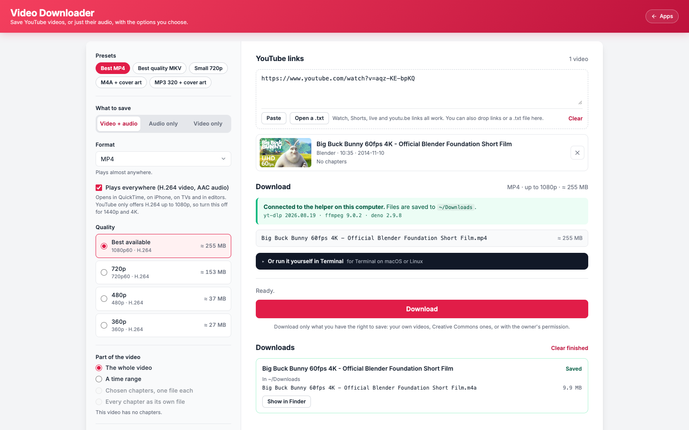

# Video Downloader

Paste YouTube links, choose the format, quality, file name, a clip or chapters, and cover art, and save them to your computer.

**Live page:** https://video-downloader.pages.dev/ · listed on [vinothhaldorai.com/apps](https://vinothhaldorai.com/apps/)



<sub>Direct mode, with the helper running. The video shown is <a href="https://peach.blender.org/">Big Buck Bunny</a>, © Blender Foundation, under CC BY 3.0.</sub>

## Why there is a helper

A web page cannot download from YouTube. YouTube refuses requests from other sites (its player API answers them with a 403), and video and audio arrive as separate, scrambled streams that need [yt-dlp](https://github.com/yt-dlp/yt-dlp) to unlock. So the page does everything you see, and yt-dlp does the fetching, on your own computer.

## Two ways to use it

**Command mode.** Open the page; there is nothing to run. Paste links, pick options, and the page writes the exact yt-dlp command. Paste it into Terminal and the file is saved where the command says.

**Direct mode.** Run the helper. You get the same page, served from your computer, and it also reads each video's real formats, sizes and chapters, then downloads with a progress bar.

## Setup

1. Install yt-dlp and ffmpeg.
   - macOS: `brew install yt-dlp ffmpeg`. Homebrew's yt-dlp brings Deno, the JavaScript runtime it needs for YouTube.
   - Windows: `winget install yt-dlp.yt-dlp Gyan.FFmpeg DenoLand.Deno`
   - Linux: `pipx install "yt-dlp[default]"`, plus ffmpeg and deno from your package manager.
2. Get the helper. Clone this repo, or download `helper.mjs` from the page. It needs Node 18 or newer and nothing else.
3. Run it:
   ```
   node helper.mjs                  # opens http://127.0.0.1:38917/ and saves to ~/Downloads
   node helper.mjs --dir ~/Videos   # saves somewhere else
   ```
   Leave the window open while you download. Ctrl+C stops it.

## What you can choose

| | |
|---|---|
| Links | One or many, one per line, or a dropped link or `.txt` file. Watch, Shorts, live, youtu.be, embed, music and mobile links all work, as does a bare video ID. Duplicates are dropped; playlists are not supported. |
| What to save | Video and audio, audio only, or video only |
| Format | MP4, MKV or WebM; M4A, MP3, Opus, FLAC or WAV |
| Quality | The best available, or a cap from 4K down to 360p, with real sizes in direct mode. "Plays everywhere" keeps MP4 to H.264 and AAC, which YouTube offers up to 1080p. |
| Part of the video | The whole video, a time range (with an optional exact cut), chosen chapters (direct mode), or every chapter as its own file |
| Metadata | Title, channel and date tags; chapter markers; the thumbnail as cover art; the thumbnail and description as separate files |
| File name | The video title, or your own text with `{title}`, `{channel}`, `{date}`, `{id}` and `{res}` |
| Advanced | Use a browser's YouTube sign-in, a speed limit, replacing existing files, ASCII or Windows-safe names |

A timestamp in a link, such as `&t=90`, becomes the start of the time range.

## When YouTube says no

- **"Sign in to confirm you're not a bot", or an age-restricted video.** Under Advanced, pick a browser where you are signed in to YouTube. On a Mac, Chrome, Edge and Brave ask for Keychain access, and Safari needs Full Disk Access for the app running the helper. If it keeps happening, add a PO-token provider such as [bgutil-ytdlp-pot-provider](https://github.com/Brainicism/bgutil-ytdlp-pot-provider); yt-dlp's [PO Token Guide](https://github.com/yt-dlp/yt-dlp/wiki/PO-Token-Guide) explains why.
- **HTTP 403, or "unable to extract".** YouTube changed something. Update yt-dlp (`brew upgrade yt-dlp`). The helper warns when yours is more than 90 days old.
- **"Requested format is not available".** Pick another quality or format.

## Security

The helper listens only on 127.0.0.1 and does only what the page can ask for.

- Requests naming any other host are refused, which stops DNS rebinding.
- Every API call carries a per-run key in a header. The page reads the key from the helper itself; other sites in your browser cannot, and the helper never approves the cross-origin preflight a custom header needs, so they cannot start downloads even blindly.
- Only YouTube video links are accepted, rebuilt as a plain watch URL.
- yt-dlp options must be on an allowlist that matches exactly what the page builds. `--exec`, config files, cookie files, paths and plugins are refused, and file names must stay inside the save folder.
- yt-dlp runs without a shell, one download at a time, with partial files kept in a temp folder until they are finished.

`node helper.mjs --self-test` checks the link parser and the allowlist. From a clone it also checks that the page's copy of the link parser still matches the helper's.

## Development

There is no build step. Open `index.html` for command mode, or run `node helper.mjs` from a clone: it serves the `index.html` beside it, so edits show on reload. Run on its own after being downloaded, the helper fetches the page once from the live site.

The page's `buildArgs()` is the only place options become yt-dlp flags. When you add an option there, add its flag to `FLAGS` in `helper.mjs` too, or the helper will refuse it.

## Deployment

Cloudflare Pages serves this repo as committed, with no build command and `/` as the output directory. CI runs the self-test.

## Licence

MIT. Download only what you have the right to save: your own videos, Creative Commons ones, or with the owner's permission. YouTube's Terms of Service only allow downloading where YouTube offers it, or with permission.
